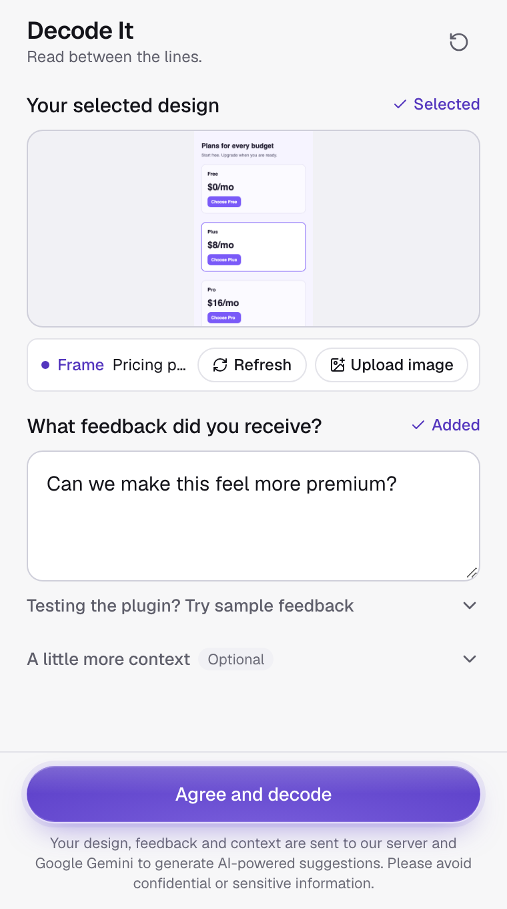
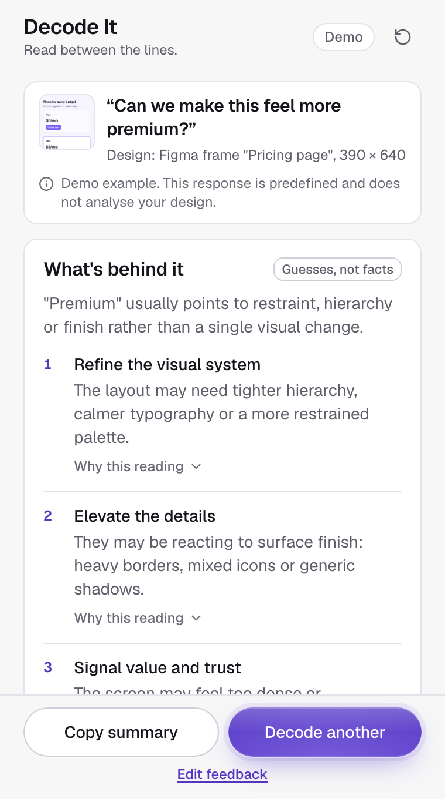

  

# Decode It

**Read between the lines of design feedback.** Decode It is a Figma plugin that takes a vague comment like
*"Can we make this feel more premium?"* together with the frame it is about, and returns two or three plausible
readings of what the reviewer might mean, specific things to check, and questions to ask them. Every reading is
labelled as a guess, never a fact.

  
  &nbsp;&nbsp;
  

Left: a frame selected in Figma, feedback pasted. Right: the result in demo mode (built-in samples, nothing sent anywhere).

## Install in Figma

**Community release is being prepared; there is no published installation link yet.** Once published, you will
install Decode It from Figma Community and run it in a design file. No API key, Cloudflare account, backend setup
or technical configuration is required to use the official plugin.

For local review before publication, contributors can [build and import the plugin](plugin/README.md#build-and-load-it-in-figma).
The [release checklist](docs/RELEASE_CHECKLIST.md) tracks what still needs verification before launch.

## Use Decode It

1. Select a frame in Figma, or add a screenshot in the plugin.
2. Paste the feedback you want to understand, such as “Make this feel more premium.”
3. Optionally add what the design is, who it is for and what it should do.
4. Read the privacy notice and press **Agree and decode** the first time.
5. Review the possible meanings, things to try and follow-up questions. Use **Copy summary** to take them into your discussion.

The readings are guesses, not facts about what the reviewer meant. Use them to decide what to check and what to ask.

## What you get

- Two or three possible readings of vague feedback, with concrete improvements to try and why.
- Useful follow-up questions when the feedback is ambiguous.
- A clear account of which design and context were used.
- Keyboard operation, screen-reader announcements and reduced-motion support.
- **Demo mode** with built-in samples: open *Testing the plugin? Try sample feedback* and tick **Demo mode**.
  Demo mode uses no AI and sends nothing anywhere.

## Privacy

In live mode, Decode It sends your selected design image, its name and size, feedback and optional notes to the
official hosted service, which uses Google Gemini to generate suggestions. Sending happens when you press Decode,
after acknowledging the notice. Avoid confidential or sensitive information.

The plugin keeps no feedback or result history. The Worker code does not persist your content; Cloudflare and Google
have their own processing and logging policies. The hosted service's plan, logging settings and privacy contact still
need confirmation before public release. Read [PRIVACY.md](PRIVACY.md) for details.

The hosted service is shared and rate limited. If it is busy or unavailable, try again later or use Demo mode.

## Contribute

Designers are welcome to suggest clearer wording, share non-sensitive examples of confusing feedback and report
usability or accessibility issues. Developers can find setup and checks in [CONTRIBUTING.md](CONTRIBUTING.md).
Please follow the [Code of Conduct](CODE_OF_CONDUCT.md). For vulnerabilities, follow [SECURITY.md](SECURITY.md).

For technical details, see the [architecture](docs/ARCHITECTURE.md), [plugin guide](plugin/README.md) and
[maintainer operations guide](docs/OPERATIONS.md). The plugin runs inside Figma; it needs no separate UI hosting.

## Licence

The source code is [MIT-licensed](LICENSE). The [logo's licensing decision](assets/brand/README.md) is pending before
public release. Third-party components and the bundled Geist font (SIL OFL 1.1) are listed in
[THIRD_PARTY_NOTICES.md](THIRD_PARTY_NOTICES.md). Decode It is independent and not affiliated with Figma, Google or Cloudflare.
